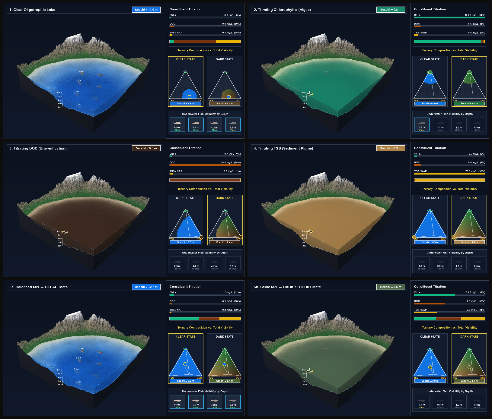

```{r setup-index, include = FALSE}
knitr::opts_chunk$set(echo = TRUE, message = FALSE, warning = FALSE, fig.align = 'center',
                      fig.width = 8.5, fig.height = 5.2, out.width = '100%')
source('R/00_setup.R')
```

# Overview & Executive Summary {-}

This technical report documents the end-to-end data harmonization, multi-stage quality control, hierarchical bio-optical modeling, and ternary partitioning workflow for **"Ternary partitioning of continental scale water clarity"** (Jawitz, Cohen, & Ross).

Water clarity—most widely measured *in situ* as Secchi disk depth ($z_{SD}$, in meters)—is governed by pure water itself ($k_w$) and three primary light-attenuating constituents (LACs): **non-algal particles (NAP)**, **dissolved organic carbon (DOC)**, and **phytoplankton chlorophyll *a* ($\text{Chl }a$)**. By combining contrast-transmittance theory ($k_d = 1 / z_{SD}$; Lee et al. 2015, 2018) with the additive Beer–Lambert law, Secchi depth can be expressed directly in terms of constituent concentrations:

$$z_{SD} = \frac{1}{k_w + \alpha_{\text{NAP}}\,\text{NAP} + \alpha_{\text{DOC}}\,\text{DOC} + \alpha_{\text{Chl }a}\,\text{Chl }a}$$

Using harmonized *in situ* records spanning **1970–2025** across the conterminous United States from the **AquaMatch** Environmental Data Initiative (EDI) data suite (Brousil et al. 2024a, 2024b, 2025; De La Torre et al. 2025), this pipeline:

1. **Harmonizes and screens multi-agency Water Quality Portal (WQP) measurements** (`Section 1`--`Section 4`), assembling **`277,382` simultaneous four-variable training observations** (`Secchi + Chl a + DOC + TSS/SSC`) and **`478,929` simultaneous three-constituent application observations** across **`39,396` unique monitoring stations** in U.S. streams, lakes, and estuaries.
2. **Applies a physically grounded, non-circular quality-control protocol** (`Section 4`) that pairs standard EPA/USGS analytical reporting floors (`ifelse(x < floor, floor, x)` rather than marginal quantile truncation) with an ***a priori* Beer–Lambert physical plausibility screen** derived strictly from published optical cross-sections (Bannister 1974; Kirk 1994; Morris et al. 1995; Gohin et al. 2005). This screen removes the **1.44%** of WQP records exhibiting severe ($>6.3\times$) physical discordance—such as unflagged streambed bottom hits in shallow, clear streams—while **preserving 100% of true environmental extremes** (`Secchi` up to $13.96\text{ m}$, `TSS` up to $978\text{ mg L}^{-1}$, `Chl a` up to $990\ \mu\text{g L}^{-1}$).
3. **Evaluates 10 hierarchical general linear models** (`Section 5`--`Section 7`) stratified across U.S. EPA Omernik Ecoregions (Levels I–IV; Omernik & Griffith 2014) and water-body types (`Estuary`, `Lake`, `Stream`), achieving $R^2 = 0.41\text{ to }0.53$ (**Model 7 $R^2 = 0.50$** across `47` Level III ecoregions) without local site-by-site calibration and demonstrating sample-size convergence for groups with $n > 1{,}000$ (`Figure S1`).
4. **Partitions continental water clarity in ternary space** (`Section 8`--`Section 9`), revealing distinct optical signatures across streams, lakes, and estuaries (`Figure 2`), river-to-estuary continuum transitions along 231 km of the Delaware River and Bay (`Figure 3`), and site-level temporal stability (*lucistatic* vs. *lucidynamic* regimes across `9,128` long-term stations; `Figure 4`).

---

## Visualizing Why Optical Partitioning & Total Visibility Matter (`{sonicray}` 3D GPU Simulation) {-}

Why does partitioning diffuse light attenuation ($k_d$) across **Chl *a***, **DOC**, and **NAP** matter physically and ecologically—and why must **ternary proportions** $(f_{\text{NAP}}, f_{\text{DOC}}, f_{\text{Chl }a})$ be interpreted alongside **total visibility** ($z_{SD} = 1 / k_d$)?

1. **Each constituent transforms the underwater light field and water color in a fundamentally different way:**
   * **Chlorophyll *a* (Phytoplankton Blooms):** Absorbs strongly in blue ($440\text{ nm}$) and red ($675\text{ nm}$) bands while phytoplankton cells backscatter green light ($550\text{ nm}$), shifting water color from deep oligotrophic blue to **luminous emerald green** as Secchi depth shoals.
   * **Dissolved Organic Carbon (CDOM / Brownification):** Absorbs exponentially across short wavelengths with virtually zero particulate backscattering, turning lakes and rivers into **dark tea-stained / mahogany blackwater** where light is extinguished rapidly without mineral turbidity.
   * **Non-Algal Particles (TSS / Sediment Plumes):** Strongly backscatter broadband red, yellow, and green wavelengths, turning water **chalky tan / turbid ochre** and driving the steepest collapse in Secchi visibility ($z_{SD} < 0.4\text{ m}$).
2. **Ternary proportions alone do not encode total visibility ($z_{SD}$):**
   * Because ternary coordinates sum to $100\%$ ($f_{\text{NAP}} + f_{\text{DOC}} + f_{\text{Chl }a} = 1$), two waterbodies sitting at the **exact same point in ternary space** (e.g., a balanced $33\%\text{ NAP}, 33\%\text{ DOC}, 33\%\text{ Chl }a$ mixture) can represent either an ultra-clear alpine lake ($z_{SD} = 5.3\text{ m}$, where submerged littoral boulders are visible) or a murky eutrophic-sediment waterbody ($z_{SD} = 0.38\text{ m}$) when total constituent concentrations scale up.
   * Pairing the ternary diagram with our calibrated Beer–Lambert Secchi depth model ($z_{SD} = 1 / [k_w + \sum \alpha_i C_i]$) resolves both **who** controls light attenuation (ternary composition) and **how much** total light is attenuated (Secchi visibility across **Clear** vs. **Dark/Turbid** states).

The simulation below—path-traced on an Apple Silicon Metal GPU using the [`{sonicray}`](https://github.com/matthewross07/sonic_ray) package—titrates **Chl *a***, then **DOC**, then **TSS/NAP** into a naturalistic 3D mountain lake basin while tracking the submerged Secchi disk profile and dynamically filling out side-by-side **Clear Water State** vs. **Dark/Turbid Water State** ternary diagrams:

<div style="margin: 1.2em 0; text-align: center;">
  <video width="100%" style="max-width: 980px; border-radius: 8px; box-shadow: 0 4px 16px rgba(0,0,0,0.22);" controls autoplay loop muted playsinline poster="figs/sonicray_optical_titration_sheet.png">
    <source src="figs/sonicray_optical_titration.mp4" type="video/mp4">
    Your browser does not support HTML5 video.
  </video>
  <p style="font-size: 0.9em; color: #475569; margin-top: 0.5em;">
    <b>Interactive 3D Bio-Optical Titration Film (rendered via <code>{sonicray}</code> on Apple Silicon Metal GPU).</b> Left: Path-traced 3D lake basin with continuous littoral bathymetry and live Secchi disk depth gauge ($z_{SD} = 1/k_d$). Right: Live constituent concentrations, attenuation partitioning, and dual dynamic ternary diagrams comparing the <b>Clear Water State</b> ($z_{SD} \approx 5.3\text{ m}$) against the <b>Dark/Turbid Water State</b> ($z_{SD} \approx 0.4\text{ m}$) across identical ternary coordinates.
  </p>
</div>

```{r sonicray-sheet, echo = FALSE, fig.cap = 'Six keyframe stages from the {sonicray} 3D lake optical titration: (1) Clear oligotrophic baseline, (2) Chlorophyll a algal bloom titration, (3) DOC humic brownification titration, (4) TSS/NAP sediment plume titration, (5) Balanced mixed composition in a Clear Water State (z_SD = 5.8 m), and (6) the exact same ternary composition at 18x concentration in a Dark/Turbid Water State (z_SD = 0.38 m).'}
if (file.exists('figs/sonicray_optical_titration_sheet.png')) {
  
}
```

---

## Data Attrition & Pipeline Funnel at a Glance {-}

```{r funnel-summary, echo = FALSE}
simul <- get_simul('simul')
no_sdd <- get_simul('no_secchi')
trimmed <- get_trimmed()
tr <- get_training()
fd <- get_final_data()
areas <- get_fig4_areas()

tribble(
  ~Stage, ~Dataset_or_Step, ~Observations, ~Unique_Sites, ~Notes,
  '1. Raw Harmonized EDI Inputs', 'AquaMatch WQP harmonized parameter records (sdd, chla, doc, tss; 1970–2025)', '12,580,000+', '150,000+', 'Retrieved via AquaMatchr::download_parameters()',
  '2. Simultaneous 3-LAC Matchups', 'Same-site, same-day Chl a + DOC + TSS/SSC (non-facility, gross caps, deduplicated)', fmt_n(nrow(no_sdd)), fmt_n(n_distinct(no_sdd$SiteID)), 'Candidate pool for ternary partitioning (Secchi optional)',
  '3. Simultaneous 4-Variable Matchups', 'Same-site, same-day Secchi + Chl a + DOC + TSS/SSC (sdd_mdl <= 1, sdd_approx == 0)', fmt_n(nrow(simul)), fmt_n(n_distinct(simul$SiteID)), 'Excludes non-Secchi turbidity tubes & <=0.01 m floor flags',
  '4. Stage 1 Analytical Floor Substitution', 'Sub-detection/zero entries floored via ifelse(x < floor, floor, x) at EPA/USGS MDLs', fmt_n(nrow(trimmed)), fmt_n(n_distinct(trimmed$SiteID)), 'Zero rows dropped; floors: Chl a 0.10 µg/L, DOC 0.25 mg/L, TSS 0.50 mg/L, Secchi 0.01 m',
  '5. Stage 2 Physical Plausibility Screen', 'A priori Beer-Lambert consistency |log10(kd / kd,lit)| <= 0.80 (~6.3x)', fmt_n(nrow(tr)), fmt_n(n_distinct(tr$SiteID)), 'Final Training Set: removes 4,057 discordant records (1.44%); preserves 100% of upper extremes',
  '6. Continental Ternary Application Set', 'All 3-LAC records within training bounds & NAP > 0.01 mg/L (Model 7 applied)', fmt_n(nrow(fd)), fmt_n(n_distinct(fd$SiteID)), sprintf('%s with measured Secchi + %s with modeled Secchi only', fmt_n(sum(fd$secchi_status == 'Measured')), fmt_n(sum(fd$secchi_status == 'Modeled'))),
  '7. Long-Term Temporal Regimes (Fig. 4)', 'Monitoring stations with > 7 simultaneous observations', fmt_n(sum(areas$n)), fmt_n(nrow(areas)), sprintf('%s streams, %s lakes, and %s estuaries', fmt_n(sum(areas$type == 'Stream')), fmt_n(sum(areas$type == 'Lake')), fmt_n(sum(areas$type == 'Estuary')))
) %>%
  kable(col.names = c('Pipeline Stage', 'Description', 'Observations (n)', 'Unique Sites', 'Key Quality-Control Rule')) %>%
  kable_styling(bootstrap_options = c('condensed', 'striped', 'hover'), full_width = TRUE)
```

---

## Automated Verification Status {-}

Every intermediate dataset, spatial join, regression model, simplex constraint, and statistical claim is continuously verified against 13 automated mathematical and bio-optical checks (`R/verify.R`):

```{r status, echo = FALSE}
v <- cache_rds('verification_summary', run_verification(), refresh = TRUE)
v %>%
  mutate(pass = ifelse(pass, '<span class="pass">✔ PASS</span>', '<span class="fail">✘ FAIL</span>'),
         expected = as.character(expected), actual = as.character(actual)) %>%
  kable(escape = FALSE, col.names = c('Pipeline Stage', 'Verification Check', 'Target / Criterion', 'Observed Value', 'Status')) %>%
  kable_styling(bootstrap_options = c('condensed', 'striped'), full_width = TRUE)
```

---

## Reproducing the Pipeline {-}

```r
# From the project root:
source('R/00_setup.R')
fetch_all()                  # Step 0: downloads harmonized AquaMatch EDI products + spatial layers
bookdown::render_book()      # Runs pipeline, generates figs/*.png & *.pdf, and builds docs/index.html
```

### Repository Architecture {-}

| Path | Role in Pipeline |
|---|---|
| `index.Rmd`, `chapters/01–10` | Narrative technical documentation (renders to `docs/index.html`) |
| `R/00_setup.R` | Package imports, directory paths, and the master parameter registry (`P`) |
| `R/00_download.R` | Programmatic downloader for AquaMatch EDI datasets (`{AquaMatchr}`), EPA ecoregions, and RiverSR |
| `R/prep.R` | Simultaneous record matching, WQP flag hygiene, Gohin et al. (2005) NAP derivation, quantile trimming, and *a priori* Beer–Lambert plausibility screening |
| `R/ecoregions.R` | Strict 1-to-1 spatial point-in-polygon and coastal nearest-feature ecoregion joins (Levels I–IV) |
| `R/models.R` | Block-diagonal OLS fitting for Models 1–10, Table 1 / Table S1 generation, Monte Carlo stability cones, and Model 7 ternary projection |
| `R/ternary.R` | Barycentric-to-Cartesian ternary geometry and exact Sutherland–Hodgman $\pm k\text{ SD}$ simplex polygon clipping |
| `R/figures.R` | Complete programmatic assembly of Figures 1–4, Figure S1, and QC diagnostic figures |
| `R/claims.R` | Parametric (Welch heteroscedastic $t$-test) and non-parametric (Wilcoxon) dominance-class hypothesis tests and literature benchmarks |
| `R/verify.R` | Automated 13-point mathematical and data-integrity verification suite |
| `figs/` | Rendered 300 dpi PNG and vector PDF manuscript figures and CSV summary tables |

---

## Summary of Methodological Decisions & Literature Provenance {-}

```{r decisions, echo = FALSE}
tribble(
  ~Decision, ~Specification, ~Literature_Support, ~Section,
  'Harmonized WQP inputs', 'AquaMatch EDI datasets via AquaMatchr (sdd edi.1856.1, chla edi.1756.2, doc edi.1809.1, tss edi.2048.2; 1970–2025)', 'Brousil et al. (2024a, 2024b, 2025); De La Torre et al. (2025)', '1',
  'Simultaneous matchups & WQP hygiene', 'Same MonitoringLocationIdentifier & date; Facility sites and non-Secchi turbidity tubes (sdd_approx > 0) excluded; sdd_mdl <= 1; same-day duplicates removed', 'Ross et al. (2019); De La Torre et al. (2025)', '2',
  'Broad unit-error caps', 'Secchi < 15 m; Chl a < 1000 ug/L; TSS < 1000 mg/L; DOC < 50 mg/L', 'Brousil et al. (2024a, 2024b, 2025)', '2',
  'Algal dry biomass & NAP', 'biomass [mg/L] = 0.234 * (Chl a)^0.57; NAP = TSS - biomass', 'Gohin et al. (2005)', '3',
  'Stage 1: Analytical reporting floors', 'Sub-detection/zero values replaced via ifelse(x < floor, floor, x) at EPA/USGS MDLs (Chl a 0.10 ug/L, DOC 0.25 mg/L, TSS 0.50 mg/L, Secchi 0.01 m; n = 281,439)', 'EPA Method 415.1; USGS NWQL; Brousil et al. (2024a, 2024b, 2025)', '4',
  'Stage 2: Physical plausibility screen', 'A priori Beer-Lambert consistency |log10(kd / kd,lit)| <= 0.80 (~6.3x) using published constants, removing 1.44% discordant WQP outliers while preserving all upper extremes (n = 277,382)', 'Bannister (1974); Kirk (1994); Morris et al. (1995); Gohin et al. (2005)', '4',
  'Diffuse attenuation from Secchi', 'kd = 1 / z_SD (Secchi rounded to 0.01 m; Eq. 1 with a = 1)', 'Lee et al. (2015, 2018)', '4',
  'Pure-water offset k_w', 'k_w = 1 / (1.5 * max z_SD) = 0.0478 m^-1 (max z_SD = 13.96 m), applied consistently in fit & prediction', 'Kirk (1994); Lee et al. (2015)', '4',
  'Additive bio-optical model', 'kd - k_w = alpha_NAP * NAP + alpha_DOC * DOC + alpha_Chl * Chl a (no intercept)', 'Bannister (1974); Kirk (1994)', '6',
  'Hierarchical ecoregions', 'U.S. EPA / CEC North American Ecoregions Levels I–IV (1-to-1 site assignment; > 100 obs per modeled group)', 'Omernik & Griffith (2014)', '5–6',
  'Primary regional model (Model 7)', 'Level III ecoregions without water-type split (47 groups, R² = 0.50; 37 strictly positive groups; fallback to Model 1)', 'Spencer et al. (2012); Griffin et al. (2018)', '6, 8',
  'Continental application set', 'All 3-LAC records inside training bounds with NAP > 0.01 mg/L (n = 478,929 across 39,396 sites)', 'Section 8', '8',
  'Site-level ternary area fraction', 'Exact Sutherland–Hodgman simplex clipping of mean ± 2 SD region normalized by sqrt(3)/4', 'Section 9', '9'
) %>% kable() %>% kable_styling(bootstrap_options = c('condensed', 'striped'), full_width = TRUE)
```
