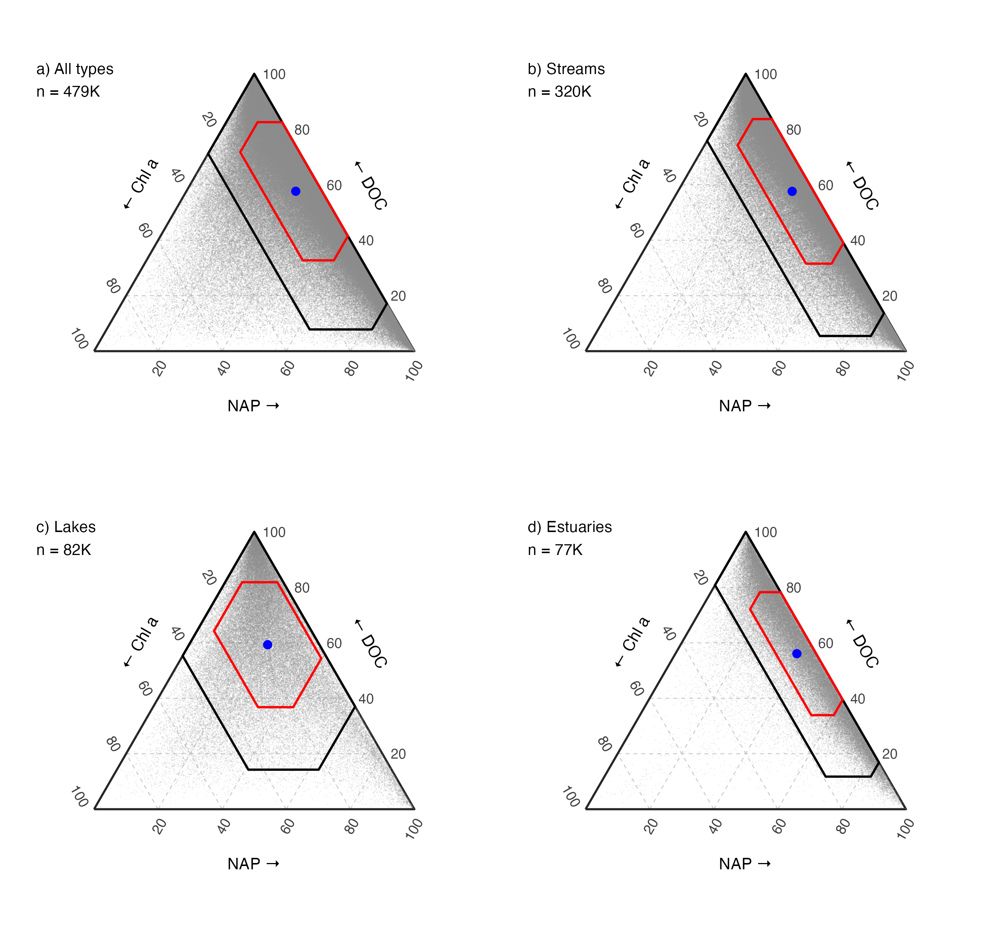

```{r setup-index, include = FALSE}
knitr::opts_chunk$set(echo = TRUE, message = FALSE, warning = FALSE, fig.align = 'center',
                      fig.width = 8.5, fig.height = 5.2, out.width = '100%')
source('R/00_setup.R')
```

# Overview {-}

Water clarity is one of our oldest and most intuitive lenses into aquatic ecosystems. For more than a century, hydrologists and limnologists have lowered Secchi disks into rivers, lakes, and estuaries to measure how deeply light penetrates the water column. Yet Secchi disk depth ($z_{SD}$, in meters) alone tells us only *how much* light is lost—not *what* is blocking it.

Across inland and coastal waters, diffuse light attenuation ($k_d = 1 / z_{SD}$; Lee et al. 2015) is governed by pure water ($k_w$) and three primary light-attenuating constituents (LACs): **non-algal particles (NAP)**, **dissolved organic carbon (DOC)**, and **phytoplankton chlorophyll *a* ($\text{Chl }a$)**. Under the additive Beer–Lambert model, Secchi depth can be written directly in terms of constituent concentrations:

$$z_{SD} = \frac{1}{k_w + \alpha_{\text{NAP}}\,\text{NAP} + \alpha_{\text{DOC}}\,\text{DOC} + \alpha_{\text{Chl }a}\,\text{Chl }a}$$

To understand how these three constituents partition water clarity across the contiguous United States, we built an open-source pipeline on top of the **AquaMatch** data suite (Brousil et al. 2024a, 2024b, 2025; De La Torre et al. 2025)—the successor to **AquaSat** (Ross et al. 2019). Combining **`277,382` simultaneous four-variable matchups** (`Secchi + Chl a + DOC + TSS/SSC`) for model calibration with **`478,929` three-constituent matchups** across **`39,396` monitoring stations** (`1970–2025`), we estimate regional specific attenuation coefficients ($\alpha_i$) across U.S. EPA Level III ecoregions and project nearly half a million water quality observations into ternary attenuation space.

---

## Why Optical Partitioning & Total Visibility Both Matter (`{sonicray}` 3D Simulation) {-}

Ternary diagrams are a powerful way to visualize which constituent dominates light attenuation ($f_{\text{NAP}} + f_{\text{DOC}} + f_{\text{Chl }a} = 1$), but proportions alone miss a critical physical dimension: **total visibility ($z_{SD}$)**. Two lakes sitting at the exact same coordinate in ternary space can represent either a crystal-clear oligotrophic basin ($z_{SD} > 5\text{ m}$) or a murky waterbody ($z_{SD} < 0.4\text{ m}$) when total constituent concentrations scale up. Moreover, each constituent alters the underwater light field in a distinct way:

* **Chlorophyll *a* (Algae):** Absorbs blue and red light while cells scatter green wavelengths, shifting water from deep blue to **emerald green**.
* **DOC (Brownification):** Absorbs short wavelengths exponentially with negligible particulate scattering, turning water into **dark tea-stained blackwater**.
* **NAP / TSS (Sediment):** Strongly backscatters broadband light, turning water **chalky tan/ochre** and driving the steepest collapse in Secchi visibility.

To visualize both ternary composition and total visibility simultaneously, we path-traced a naturalistic 3-hill lake basin on an Apple Silicon Metal GPU using [`{sonicray}`](https://github.com/matthewross07/sonic_ray)'s native dielectric and Beer–Lambert water engine (`sr_upload_mesh(water = ...)` + `sr_water_preset()`). Four submerged 3D trout and white Secchi spheres sit at `0.4 m`, `0.9 m`, `1.5 m`, and `2.1 m` depth. In **Act I (Clear Water Regime)**, low constituent loads shift the ternary position while all four depth tiers remain visible; in **Act II (Dark/Turbid Regime)**, high loads of **Chl *a***, **DOC**, and **TSS** shift the ternary diagram into its dark regime and progressively extinguish visibility from `2.1 m` up to `0.4 m`:

<div style="margin: 1.2em 0; text-align: center;">
  <video width="100%" style="max-width: 980px; border-radius: 8px; box-shadow: 0 4px 16px rgba(0,0,0,0.22);" controls autoplay loop muted playsinline poster="figs/sonicray_optical_titration_sheet.png">
    <source src="figs/sonicray_optical_titration.mp4" type="video/mp4">
    Your browser does not support HTML5 video.
  </video>
  <p style="font-size: 0.9em; color: #475569; margin-top: 0.5em;">
    <b>3D Bio-Optical Titration Film (path-traced in <code>{sonicray}</code>).</b> Left: 3D lake basin with submerged fish and Secchi spheres at <code>0.4 m</code>, <code>0.9 m</code>, <code>1.5 m</code>, and <code>2.1 m</code>. Right: Live constituent titration and a dynamic ternary diagram transitioning from the <b>Clear Water Regime</b> (Act I) into the <b>Dark/Turbid Regime</b> (Act II).
  </p>
</div>

```{r sonicray-sheet, echo = FALSE, fig.cap = 'Six keyframe stages from the {sonicray} 3D water titration: (1–3) Act I Clear Water Regime across oligotrophic and low-load ternary sweeps (fish and Secchi spheres remain visible across 0.4–2.1 m), followed by (4–6) Act II Dark/Turbid Regime during an algal bloom (high Chl a), brownification (high DOC), and a sediment plume (high TSS).'}
if (file.exists('figs/sonicray_optical_titration_sheet.png')) {
  knitr::include_graphics('figs/sonicray_optical_titration_sheet.png')
}
```

---

## Continental Ternary Partitioning at a Glance {-}

Across `478,929` co-located U.S. water quality samples, dissolved organic matter (**DOC**, `58.8%`) and non-algal suspended sediment (**NAP**, `33.0%`) dominate average non-water light attenuation in streams and estuaries, whereas lakes span the full ternary simplex with more than double the phytoplankton attenuation share (**Chl *a***, `16.5%` vs. `6.7%` in streams and `5.8%` in estuaries):

```{r overview-fig2-preview, echo = FALSE, fig.cap = 'Continental ternary partitioning of non-water light attenuation across (a) all U.S. waters (n = 478,929), (b) streams, (c) lakes, and (d) estuaries (see Section 8 and Section 9 for full diagnostics).'}
if (file.exists('figs/fig2_ternary_by_type.png')) {
  
}
```

---

## Pipeline Funnel & Dataset Summary {-}

```{r funnel-summary, echo = FALSE}
simul <- get_simul('simul')
no_sdd <- get_simul('no_secchi')
trimmed <- get_trimmed()
tr <- get_training()
fd <- get_final_data()
areas <- get_fig4_areas()

tribble(
  ~Stage, ~Dataset_or_Step, ~Observations, ~Unique_Sites, ~Notes,
  '1. Raw AquaMatch Inputs', 'Harmonized WQP records (sdd, chla, doc, tss; 1970–2025)', '12,580,000+', '150,000+', 'Downloaded via AquaMatchr (Section 1)',
  '2. 3-Constituent Matchups', 'Same-site, same-day Chl a + DOC + TSS/SSC', fmt_n(nrow(no_sdd)), fmt_n(n_distinct(no_sdd$SiteID)), 'Ambient Stream, Lake, and Estuary stations (Section 2)',
  '3. 4-Variable Matchups', 'Same-site, same-day Secchi + Chl a + DOC + TSS/SSC', fmt_n(nrow(simul)), fmt_n(n_distinct(simul$SiteID)), 'Excludes turbidity tubes & <=0.01 m floor flags (Section 2)',
  '4. Analytical Floor Step', 'Sub-detection values floored at EPA/USGS MDLs', fmt_n(nrow(trimmed)), fmt_n(n_distinct(trimmed$SiteID)), 'Chl a 0.10 µg/L, DOC 0.25 mg/L, TSS 0.50 mg/L (Section 4)',
  '5. Beer–Lambert QC Screen', 'A priori optical plausibility |log10(kd / kd,lit)| <= 0.80', fmt_n(nrow(tr)), fmt_n(n_distinct(tr$SiteID)), 'Final Training Set: removes 1.44% discordant outliers (Section 4)',
  '6. Continental Application', 'All 3-constituent matchups inside training bounds (Model 7)', fmt_n(nrow(fd)), fmt_n(n_distinct(fd$SiteID)), sprintf('%s Measured + %s Modeled Secchi (Section 8)', fmt_n(sum(fd$secchi_status == 'Measured')), fmt_n(sum(fd$secchi_status == 'Modeled'))),
  '7. Temporal Stability Set', 'Long-term stations with > 7 matchups (Fig. 4)', fmt_n(sum(areas$n)), fmt_n(nrow(areas)), sprintf('%s streams, %s lakes, %s estuaries (Section 9)', fmt_n(sum(areas$type == 'Stream')), fmt_n(sum(areas$type == 'Lake')), fmt_n(sum(areas$type == 'Estuary')))
) %>%
  kable(col.names = c('Stage', 'Description', 'Observations (n)', 'Unique Sites', 'Pipeline Section')) %>%
  kable_styling(bootstrap_options = c('condensed', 'striped', 'hover'), full_width = TRUE)
```

---

## Reproducing the Workflow & Code Architecture {-}

```r
source('R/00_setup.R')
fetch_all()                  # Downloads harmonized AquaMatch EDI products + spatial layers
bookdown::render_book()      # Runs pipeline, saves figs/*.png & *.pdf, builds docs/index.html
```

| Script / Folder | Role |
|---|---|
| `R/00_setup.R`, `R/00_download.R` | Package setup, parameter registry (`P`), and programmatic `{AquaMatchr}` / spatial data retrieval |
| `R/prep.R` | Same-day matchup assembly, Gohin et al. (2005) NAP derivation, MDL floors, and Beer–Lambert plausibility screening |
| `R/ecoregions.R`, `R/models.R` | EPA Level I–IV ecoregion joins, Models 1–10 OLS fitting, stability cones, and Model 7 ternary projection |
| `R/ternary.R`, `R/figures.R` | Ternary geometry, Sutherland–Hodgman $\pm k\text{ SD}$ polygon clipping, and Figures 1–4 / S1 |
| `R/sonicray_lake.R` | Apple Silicon Metal GPU 3D lake optical titration renderer (`{sonicray}`) |
| `R/claims.R`, `R/verify.R` | Dominance-regime hypothesis tests and automated 13-point verification audit (`Section 10`) |
